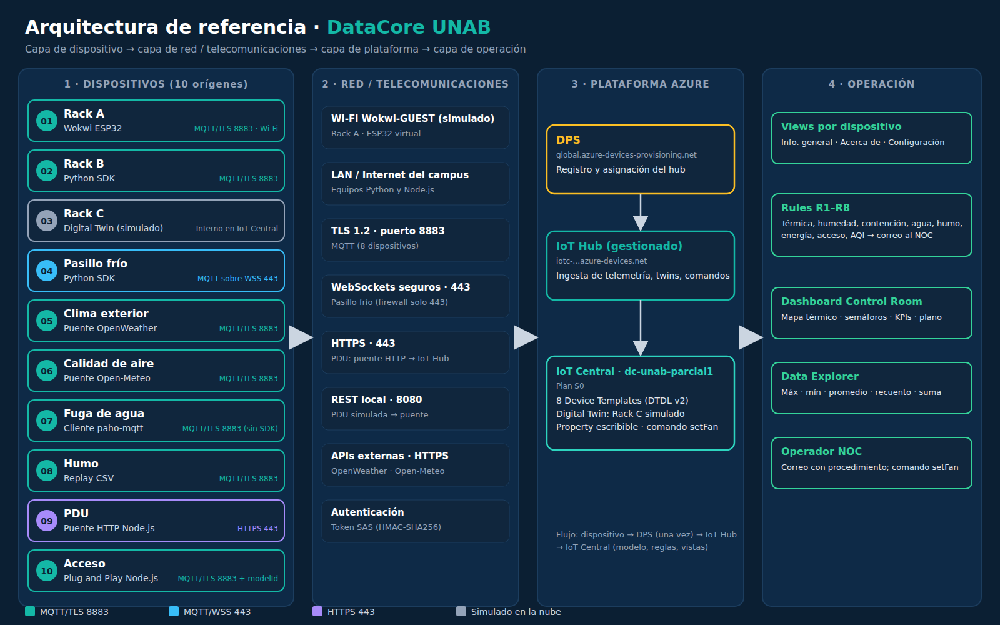

<p align="center"></p>

# DataCore UNAB · Escenario IoT Central con flota heterogénea de 10 dispositivos

Parcial 1 · IoT + Cloud + Sistemas Distribuidos · Universidad Autónoma de Bucaramanga · 2026-II
**Escenario 5.2 – Centro de datos.** Integrantes: David Eduardo Guerrero Portilla · David Santiago Gonzales Nigrinis. Docente: Ing. Javier Pinzón Castellanos.

Monitoreo de una sala de servidores en Azure IoT Central (plan S0) con 10 dispositivos, cada uno con un **origen de envío distinto**, capturas en 4 días (25, 26, 27 y 28 de septiembre de 2026), reglas con alertas por correo y un dashboard tipo *control room*.



## Catálogo de dispositivos

| # | ID | Zona | Origen de envío | Protocolo | Intervalo | Carpeta |
|---|---|---|---|---|---|---|
| 01 | dc-rack-a | Rack A | Wokwi (ESP32 virtual, C++) | MQTT/TLS 8883 | 15 s | `wokwi_rack_a/` |
| 02 | dc-rack-b | Rack B | Python (SDK azure-iot-device) | MQTT/TLS 8883 | 30 s | `python_rack_b/` |
| 03 | dc-rack-c | Rack C | Digital Twin / simulador de IoT Central | Interno | Central | `plantillas_dtdl/01_DC-Rack.json` |
| 04 | dc-pasillo-frio | Pasillo frío | Python con otro transporte | MQTT sobre WebSockets 443 | 60 s | `python_pasillo_frio/` |
| 05 | dc-clima-ext | Exterior | Feed meteorológico OpenWeather | HTTPS → MQTT | 5 min | `openweather_clima/` |
| 06 | dc-aire | Toma de free-cooling | API pública Open-Meteo Air Quality | HTTPS → MQTT | 10 min | `api_calidad_aire/` |
| 07 | dc-agua | Piso técnico | MQTT explícito con paho (sin SDK: SAS y DPS a mano) | MQTT/TLS 8883 | 60 s + evento | `mqtt_fuga_agua/` |
| 08 | dc-humo | Techo | Replay de CSV histórico (simulacro) | MQTT/TLS 8883 | 30 s | `csv_humo/` |
| 09 | dc-pdu | Fila 1 | Puente HTTP/REST en Node.js | HTTPS 443 | 60 s | `node_pdu/` |
| 10 | dc-acceso | Puerta | Dispositivo IoT Plug and Play (Node.js) | MQTT/TLS 8883 | Evento + 5 min | `node_acceso/` |

Siete cadencias distintas (15 s, 30 s, 60 s, 5 min, 10 min, por evento y la del simulador) dan la asincronía exigida.

## Decisiones de diseño

- **Un solo Digital Twin para los tres racks** (`DC-Rack`): el mismo modelo lo usan un dispositivo real simulado (Wokwi), un script (Python) y el simulador de Central, lo que permite compararlos en un mismo mapa térmico. Incluye telemetría, una *property* escribible (`alarmThreshold`) y un comando (`setFan`).
- **Plan S0**: la captura es por ventanas, no 24/7; S0 cuesta menos que S2 para ~15 000 mensajes.
- **Diez orígenes realmente distintos**: cambian el lenguaje, el transporte (MQTT, WebSockets, HTTPS), el nivel de abstracción (SDK, paho a mano, firmware) y la fuente del dato (sensor, modelo, API real, histórico, Plug and Play).
- **OpenWeather en lugar de Azure Maps**: la suscripción Azure for Students bloqueó Azure Maps por política de regiones.
- **Wokwi conectado directo al hub**: el TLS simulado de Wokwi es lento para DPS; el dispositivo se registra una vez con `provision_once.py` y el ESP32 usa `IOT_HUB_HOST`.
- **Reglas**: magnitudes continuas con promedio de 5 min (evita falsas alarmas); eventos sin agregación o con *Máximo* (evita un correo por mensaje).
- **Umbrales**: ASHRAE A1 (18–27 °C), US EPA AQI, Resolución 2254 de 2017.

## Reglas

| Regla | Condición | Agregación |
|---|---|---|
| R1 Temperatura de entrada alta | tempIntake mayor que 27 °C | Promedio 5 min |
| R2 Humedad alta en rack | humidity mayor que 60 % | Promedio 5 min |
| R3 Pérdida de contención | diffPressure menor que 3 Pa | Promedio 5 min |
| R4 Fuga de agua | leakDetected = true | Ninguna |
| R5 Humo detectado | smoke ≥ 2,5 %/ft o ceilingTemp mayor que 35 °C | Máximo 5 min |
| R6 Sobrecarga de PDU | power mayor que 7 kW o powerFactor menor que 0,9 | Promedio 5 min |
| R7 Puerta forzada | accessEvent = PUERTA_FORZADA | Ninguna |
| R8 Aire exterior contaminado | aqi mayor que 100 | Ninguna |

R1 a R7 se dispararon con correo durante la captura (ver `evidencias/capturas/`). R8 depende del aire real de Bucaramanga, que se mantuvo en AQI 44–71.

## Cómo ejecutar

Credenciales **solo** por variables de entorno (`IOTC_ID_SCOPE`, `IOTC_DEVICE_ID`, `IOTC_DEVICE_KEY`, `OPENWEATHER_KEY`) o en `wokwi_rack_a/secrets.h`, que no se sube. Plantilla: `control_flota/iniciar.example.ps1`.

```powershell
# Python (Rack B, pasillo, clima, aire, fuga, humo)
pip install -r python_rack_b/requirements.txt
python python_rack_b/rack_b.py

# Node.js (PDU y acceso)
cd node_pdu;   npm install; node pdu_simulada.js   # y en otra consola: node puente_http.js
cd node_acceso; npm install; node acceso_pnp.js     # teclas: a = autorizado, d = denegado, f = forzada
```

**Wokwi:** crear un proyecto ESP32, copiar `sketch.ino`, `diagram.json`, `libraries.txt`, `azure_ca.h` y `secrets.example.h` (renombrado a `secrets.h`, con la clave y `IOT_HUB_HOST`).

**Toda la flota con un comando:** `control_flota/INICIAR_CAPTURA.bat` (arranca los 8 dispositivos locales, abre Wokwi y detiene todo a las 4 h) y `DETENER_CAPTURA.bat`. Cada ventana queda registrada en `registro_capturas.csv`.

## Versiones relevantes

- `sketch.ino` **1.0.5**: 1.0.4 añadió el modelo del ventilador; 1.0.5 resincroniza NTP cada 10 min y antes de reconectar, reinicia el Wi-Fi tras 1 min sin hub y reinicia el ESP32 tras 5 min. Motivo: en Wokwi el reloj del ESP32 se atrasa y el token SAS, firmado con ese reloj, termina rechazado (estado 5).
- `rack_b.py` **1.1.0**: reversión a la media en la temperatura (la 1.0.0 derivaba hacia arriba).
- `iniciar_todo.ps1` **1.2.0**: no relanza la flota si ya está corriendo.

## Evidencias

- `evidencias/logs/`: logs completos de los 8 dispositivos locales (hora local, UTC−5; Node en UTC).
- `evidencias/exportes/`: exportaciones CSV de Data Explorer por día.
- `evidencias/capturas/`: correos de las reglas, dashboards de cierre y gráficas.
- `evidencias/registro_capturas.csv`: inicio y fin de cada ventana de captura.

## Seguridad

Ninguna clave de dispositivo ni de API está en el repositorio. Si una clave se expone, se regenera en IoT Central (Dispositivo → Conectar → Regenerar clave principal).
